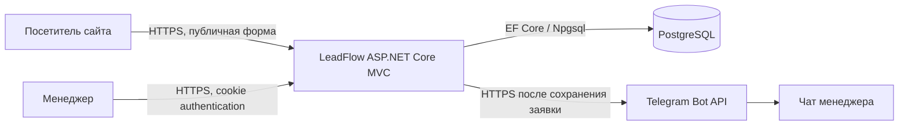
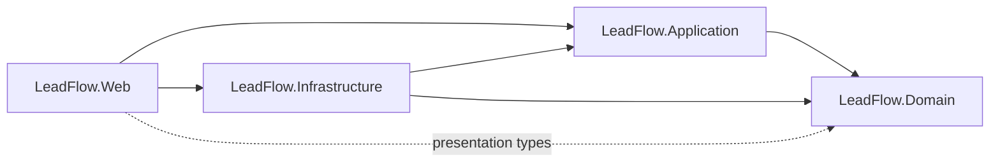
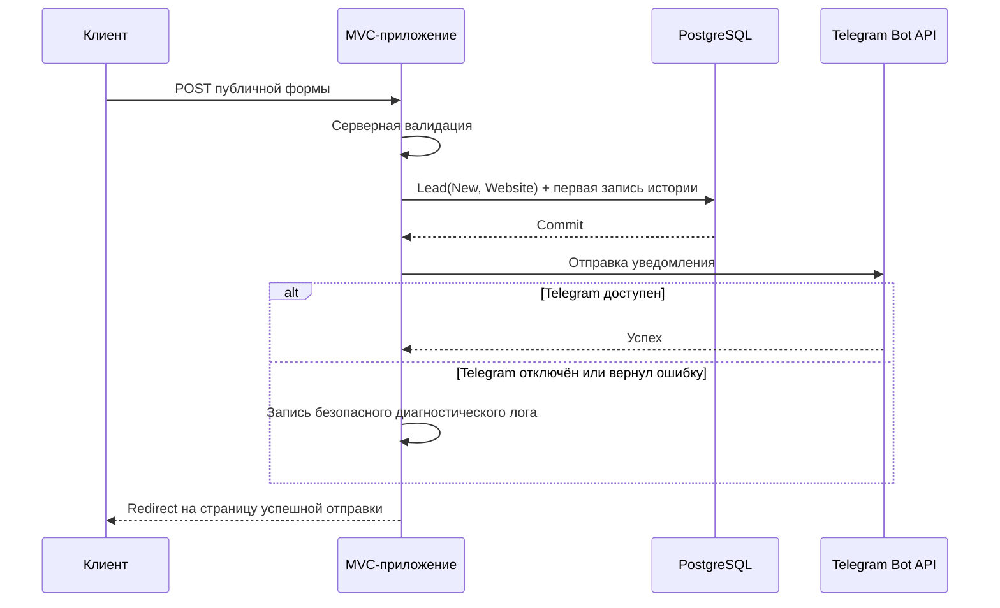

# LeadFlow — архитектура приложения

## 1. Статус документа

Этот документ фиксирует целевую архитектуру LeadFlow после завершения MVP и является основой для последующего плана реализации и рефакторинга.

Архитектура считается утверждённой после явного согласования пользователем. После утверждения изменения архитектурных решений выполняются только через отдельный согласованный пересмотр этого документа.

Редакция с разделением решения на проекты имеет статус **Proposed** до отдельного утверждения. Причины, альтернативы и последствия решения зафиксированы в `docs/adr/0001-split-solution-into-layered-projects.md`.

## 2. Архитектурные цели

Архитектура должна:

- обеспечивать полный бизнес-сценарий из `REQUIREMENTS.md`;
- оставаться простой для разработки и демонстрации;
- разделять веб-интерфейс, бизнес-логику и внешние интеграции;
- безопасно хранить персональные данные и учётные данные менеджера;
- не терять заявку при сбое Telegram;
- позволять расширять источники заявок и способы уведомления без переработки основного сценария.

Не являются целями MVP:

- микросервисная архитектура;
- отдельный SPA/frontend;
- универсальная CRM-платформа;
- event bus и распределённые транзакции;
- сложная ролевая модель;
- универсальные репозитории поверх Entity Framework Core.

## 3. Архитектурный стиль

LeadFlow реализуется как модульный монолит: одно ASP.NET Core MVC-приложение, одна база данных PostgreSQL и одна внешняя интеграция с Telegram Bot API.

Внутри приложения используются следующие логические слои:

1. **Presentation** — MVC controllers, Razor views и view models.
2. **Application** — сценарии создания и обработки заявок, управление статусами и координация уведомлений.
3. **Domain** — бизнес-сущности, статусы и источники заявок.
4. **Infrastructure** — Entity Framework Core, ASP.NET Core Identity, PostgreSQL и клиент Telegram Bot API.

Логические слои разделяются на проекты `LeadFlow.Web`, `LeadFlow.Application`, `LeadFlow.Domain` и `LeadFlow.Infrastructure`. Это физически закрепляет направления зависимостей, но не превращает приложение в распределённую систему: запускается и развёртывается только `LeadFlow.Web`, база данных остаётся общей.

Прямой доступ controllers к `DbContext` не допускается. Controllers работают через `LeadCreationService`, `LeadManagementService`, query-сервисы и их контракты. Application-сервисы зависят от `IApplicationDbContext`, а инфраструктура предоставляет реализацию на EF Core. Entity Framework Core используется как unit of work; отдельный generic repository не вводится.

## 4. Контекст системы



Приложение является единственной точкой доступа к данным. PostgreSQL и Telegram Bot API не доступны напрямую из браузера.

## 5. Технологический стек

- .NET 10 и ASP.NET Core MVC;
- Razor Views для лендинга и административной части;
- Entity Framework Core с провайдером Npgsql;
- PostgreSQL, локально запускаемый через Docker Compose;
- ASP.NET Core Identity для хранения пользователя, хеширования пароля и входа;
- cookie authentication для административной части;
- typed `HttpClient` для Telegram Bot API;
- xUnit для автоматических тестов;
- `WebApplicationFactory` для MVC/integration tests;
- PostgreSQL в Testcontainers для проверок поведения, зависящего от реальной СУБД.

Конкретные совместимые версии NuGet-пакетов выбираются при реализации под целевую платформу `net10.0` и фиксируются в проектных файлах.

## 6. Структура решения

Целевая структура решения:

```text
LeadFlow.sln
├── LeadFlow.Web/
│   ├── Areas/
│   │   └── Admin/
│   │       ├── Controllers/
│   │       ├── ViewModels/
│   │       └── Views/
│   ├── Controllers/
│   ├── ViewModels/
│   ├── Views/
│   ├── wwwroot/
│   └── Program.cs
├── LeadFlow.Application/
│   ├── Authentication/
│   ├── Leads/
│   │   ├── Creation/
│   │   ├── Listing/
│   │   └── Management/
│   ├── Managers/
│   ├── Notifications/
│   └── Persistence/
├── LeadFlow.Domain/
│   └── Leads/
├── LeadFlow.Infrastructure/
│   ├── Identity/
│   ├── Persistence/
│   │   ├── Configurations/
│   │   └── Migrations/
│   ├── Telegram/
│   └── DependencyInjection.cs
├── LeadFlow.Tests/
│   ├── Unit/
│   └── Integration/
├── docs/
│   └── adr/
├── compose.yaml
├── REQUIREMENTS.md
├── ARCHITECTURE.md
└── IMPLEMENTATION_PLAN.md
```

`LeadFlow.Web/Program.cs` остаётся composition root. Регистрация инфраструктуры инкапсулируется extension-методами проекта `LeadFlow.Infrastructure`, но их вызов и сборка приложения выполняются в `Program.cs`.

### 6.1. Направления зависимостей



- `LeadFlow.Domain` не имеет ссылок на остальные проекты решения и инфраструктурные библиотеки;
- `LeadFlow.Application` содержит прикладные сервисы, команды, query-модели, DTO и интерфейсы внешних зависимостей; из инфраструктурных пакетов допускаются только EF Core abstractions, необходимые для `IApplicationDbContext` и LINQ-запросов;
- `LeadFlow.Infrastructure` реализует persistence-, Identity- и Telegram-контракты Application;
- `LeadFlow.Web` содержит только HTTP/UI-слой и composition root;
- `LeadFlow.Tests` может ссылаться на все проекты для unit- и integration-проверок.

Циклические ссылки между проектами не допускаются. Ссылка `Web` на `Infrastructure` используется для композиции зависимостей, а не для обращения controllers к инфраструктурным типам.

Controllers не используют `ApplicationDbContext`, `ApplicationUser`, `UserManager<ApplicationUser>` или `SignInManager<ApplicationUser>`. Для входа и выхода `AccountController` зависит от `IManagerAuthenticationService`, объявленного в Application. Реализация в Infrastructure адаптирует этот контракт к ASP.NET Core Identity. Для получения отображаемых данных менеджера Application использует отдельный read-контракт `IManagerDirectory`, также реализуемый Infrastructure.

### 6.2. Организация Application

Application-код группируется по прикладным сценариям, а не в общих корневых каталогах `Commands` и `DTO`. Существующие `LeadCreationService`, `LeadManagementService` и `LeadListQueryService` сохраняются и располагаются рядом со своими командами, результатами и интерфейсами. Такое размещение поддерживает связность сценариев и не создаёт общий каталог несвязанных типов.

Контракты аутентификации и чтения сведений о менеджерах отделяются от реализаций Identity:

- `IManagerAuthenticationService` выполняет вход и выход и возвращает нейтральный результат без типов ASP.NET Core Identity;
- `IManagerDirectory` разрешает необходимые application-сценариям сведения о менеджерах, например email авторов истории, по их идентификаторам;
- реализации этих контрактов находятся в Infrastructure и могут использовать `SignInManager<ApplicationUser>`, `UserManager<ApplicationUser>` или `ApplicationDbContext`;
- возврат `ApplicationUser` за границу Infrastructure не допускается.

## 7. Доменная и Identity-модели

### 7.1. Lead

Заявка содержит:

| Поле | Тип | Правило |
|---|---|---|
| `Id` | `Guid` | Генерируется приложением |
| `Name` | `string` | Обязательно, до 100 символов |
| `Phone` | `string` | Обязательно, до 50 символов |
| `Email` | `string?` | Необязательно, до 254 символов, проверяется формат |
| `Service` | `string` | Обязательно, до 150 символов |
| `CustomerComment` | `string?` | Необязательно, до 2000 символов |
| `ManagerComment` | `string?` | Одно редактируемое поле, до 4000 символов |
| `CreatedAtUtc` | `DateTimeOffset` | Устанавливается сервером в UTC |
| `Status` | `LeadStatus` | При создании всегда `New` |
| `Source` | `LeadSource` | Для лендинга всегда `Website` |

Значение услуги хранится в заявке как текстовый снимок. Список услуг лендинга задаётся конфигурацией приложения и проверяется на сервере. Отдельное управление каталогом услуг в MVP не требуется.

### 7.2. LeadStatus

Допустимые значения:

- `New` — Новая;
- `InProgress` — В работе;
- `Completed` — Выполнена;
- `Rejected` — Отказ.

Требования не задают ограниченный граф переходов, поэтому менеджер может вручную выбрать любой допустимый статус. При выборе уже установленного статуса новая запись истории не создаётся.

### 7.3. LeadSource

Для расширяемости источник представлен enum. В MVP используется `Website`. Значения `Telegram`, `Avito`, `Vk` и `Other` могут быть добавлены при появлении соответствующих сценариев; неиспользуемые интеграции в MVP не реализуются.

### 7.4. LeadStatusHistory

История статусов содержит:

| Поле | Тип | Правило |
|---|---|---|
| `Id` | `Guid` | Уникальный идентификатор |
| `LeadId` | `Guid` | Внешний ключ на заявку |
| `PreviousStatus` | `LeadStatus?` | `null` для создания заявки |
| `NewStatus` | `LeadStatus` | Новый статус |
| `ChangedAtUtc` | `DateTimeOffset` | Время изменения в UTC |
| `ChangedByUserId` | `Guid?` | `null` при создании, пользователь при ручном изменении |

Создание заявки и первой записи истории со статусом `New` выполняется одним вызовом `SaveChanges` и одной транзакцией БД. Изменение статуса и добавление записи истории также сохраняются атомарно.

Domain хранит только скалярный `ChangedByUserId` и не содержит навигационного свойства на `ApplicationUser`. Связь с таблицей Identity настраивается в EF Core-конфигурации Infrastructure без зависимости Domain от Identity. Email автора, необходимый для карточки заявки, разрешается в Application через `IManagerDirectory`.

### 7.5. Identity-модель ApplicationUser

`ApplicationUser` относится к `LeadFlow.Infrastructure/Identity` и не входит в проекты Domain, Application или Web, поскольку зависит от ASP.NET Core Identity. Пользователь менеджера наследуется от `IdentityUser<Guid>`. В MVP:

- существует один предварительно созданный менеджер;
- регистрации, восстановления пароля и UI управления пользователями нет;
- роли не используются, поскольку любой аутентифицированный пользователь является менеджером;
- пароль хранится только в формате, создаваемом ASP.NET Core Identity password hasher.

## 8. Хранение данных

Используется один `ApplicationDbContext`, включающий таблицы Identity, заявки и историю статусов. Контекст и EF-конфигурации находятся в `LeadFlow.Infrastructure`; контекст реализует объявленный в `LeadFlow.Application` контракт `IApplicationDbContext`. Этот application-контракт предоставляет только наборы и операции, необходимые сценариям заявок, и не раскрывает `ApplicationUser` или Identity API.

Application-сервисы продолжают формировать конкретные LINQ-запросы и использовать EF Core как unit of work через этот контракт. Введение `IApplicationDbContext` закрепляет направление зависимости между проектами и не является generic repository.

Основные ограничения и индексы:

- обязательность и максимальная длина строк задаются и в модели, и в схеме БД;
- enum заявки и истории хранятся строковыми значениями для читаемости данных;
- индекс по `Lead.Status` и `Lead.CreatedAtUtc` поддерживает фильтрацию и сортировку списка;
- индекс по `LeadStatusHistory.LeadId` поддерживает загрузку истории карточки;
- удаление заявки через пользовательский интерфейс отсутствует;
- история удаляется каскадно только при техническом удалении родительской заявки вне MVP.

Миграции EF Core хранятся в `LeadFlow.Infrastructure`. Startup-проектом для design-time команд остаётся `LeadFlow.Web`. Миграции применяются явной командой до запуска приложения. Автоматическое применение миграций при старте не используется, чтобы запуск приложения не менял схему базы неявно.

Для локальной разработки `compose.yaml` поднимает PostgreSQL с persistent volume и healthcheck. Само MVC-приложение запускается через .NET CLI/IDE; контейнеризация приложения не обязательна для MVP.

## 9. Основные пользовательские сценарии

### 9.1. Создание заявки



Критически важный порядок: сначала фиксируется заявка, затем вызывается Telegram. Ошибка или отсутствие конфигурации Telegram не откатывает и не удаляет заявку.

После успешного POST используется паттерн Post/Redirect/Get, чтобы обновление страницы не создавало повторную заявку.

### 9.2. Работа менеджера

1. Менеджер открывает `/admin/login` и входит по email и паролю.
2. После успешного входа перенаправляется на `/admin/leads`.
3. Список по умолчанию сортируется от новых к старым и может фильтроваться по статусу.
4. Менеджер открывает `/admin/leads/{id}`.
5. В карточке видит данные заявки и историю статусов.
6. Менеджер изменяет статус и/или единое поле внутреннего комментария.
7. Приложение сохраняет изменения; при фактической смене статуса атомарно добавляет запись истории.

Все routes внутри `/admin`, кроме страницы входа, требуют аутентификацию.

## 10. MVC и HTTP-контракты

Публичная часть:

| Метод и route | Назначение |
|---|---|
| `GET /` | Лендинг и форма заявки |
| `POST /leads` | Создание заявки |
| `GET /leads/success` | Подтверждение успешной отправки |

Административная часть:

| Метод и route | Назначение |
|---|---|
| `GET /admin/login` | Форма входа |
| `POST /admin/login` | Проверка учётных данных |
| `POST /admin/logout` | Выход |
| `GET /admin/leads` | Список и фильтрация заявок |
| `GET /admin/leads/{id}` | Карточка заявки и история |
| `POST /admin/leads/{id}` | Изменение статуса и комментария |

Отдельный публичный REST API в MVP не требуется. Telegram Bot API остаётся демонстрацией интеграции со сторонним REST API.

Domain entities не передаются напрямую между controllers и views. Для ввода и отображения используются отдельные view models с Data Annotations. Все изменяющие POST-запросы защищены antiforgery token.

## 11. Валидация и нормализация

Публичная форма:

- `Name`, `Phone` и `Service` обязательны;
- `Email` и `CustomerComment` необязательны;
- email при наличии проверяется стандартным валидатором;
- строковые значения обрезаются по краям;
- пустые необязательные значения преобразуются в `null`;
- `Service` должен присутствовать в настроенном списке услуг;
- для телефона применяется проверка наличия значения и ограничения длины без жёсткой маски конкретной страны.

Административная форма принимает только допустимый enum статуса и внутренний комментарий разрешённой длины. Идентификатор пользователя и время изменения определяются сервером.

Ошибки валидации возвращают ту же форму с понятными сообщениями и не изменяют базу данных.

## 12. Аутентификация и авторизация

Используется ASP.NET Core Identity с cookie authentication.

`AccountController` зависит от `IManagerAuthenticationService` из Application и не использует Identity-типы. Реализация `IdentityManagerAuthenticationService` находится в Infrastructure и инкапсулирует `SignInManager<ApplicationUser>`. Контракт возвращает нейтральный результат успеха или неуспеха, поэтому детали Identity, lockout и cookie не пересекают границу Infrastructure. Проверка локального `returnUrl` и выбор HTTP redirect остаются ответственностью Web.

- начальный менеджер создаётся идемпотентным initializer при запуске, если его ещё нет;
- email и начальный пароль передаются через User Secrets или environment variables;
- отсутствие настроек начального менеджера не раскрывает секреты и не создаёт пользователя с паролем по умолчанию;
- административные endpoints защищаются общей authorization policy;
- cookie имеет флаги `HttpOnly`, `Secure` и `SameSite=Lax`;
- login использует нейтральное сообщение об ошибке без раскрытия существования пользователя;
- небезопасные значения `returnUrl` не используются для внешнего перенаправления;
- публичной регистрации нет.

Если база данных ещё не мигрирована или недоступна, initializer завершает запуск с понятной ошибкой. Если параметры начального менеджера отсутствуют, приложение запускается, но вход невозможен до безопасного создания пользователя через конфигурацию и повторный запуск.

## 13. Telegram-интеграция

Прикладной код зависит от интерфейса `ILeadNotificationSender`. Инфраструктура предоставляет две реализации:

- `TelegramLeadNotificationSender` — отправляет сообщение через Telegram Bot API;
- `DisabledLeadNotificationSender` — ничего не отправляет и используется при неполной конфигурации.

Конфигурация:

- `Telegram:BotToken`;
- `Telegram:ChatId`.

Секретные значения передаются через User Secrets или environment variables (`Telegram__BotToken`, `Telegram__ChatId`) и не сохраняются в `appsettings*.json` или репозитории.

Сообщение содержит имя, телефон, услугу и комментарий клиента при его наличии. Данные экранируются в соответствии с выбранным режимом Telegram-разметки либо отправляются без `parse_mode`, чтобы пользовательский ввод не влиял на формат сообщения.

Telegram вызывается только после успешного сохранения заявки. Внешний вызов имеет короткий timeout и принимает `CancellationToken`. Ошибка HTTP, timeout или исключение перехватываются на границе интеграции и логируются без токена и полного содержимого заявки. Клиент всё равно получает подтверждение успешного сохранения.

В MVP используется best-effort доставка без фоновых повторов и transactional outbox. Это выполняет требование о сохранности заявки при сбое уведомления. Гарантированная повторная доставка может быть добавлена позже через outbox без изменения controllers и доменной модели.

## 14. Конфигурация

Несекретная конфигурация хранится в `appsettings.json` и может переопределяться environment variables. Секреты используются только из User Secrets или environment variables.

Предусматриваются следующие секции:

| Ключ | Назначение | Секрет |
|---|---|---|
| `ConnectionStrings:DefaultConnection` | PostgreSQL connection string | Да |
| `InitialManager:Email` | Email начального менеджера | Нет |
| `InitialManager:Password` | Начальный пароль | Да |
| `Telegram:BotToken` | Токен Telegram-бота | Да |
| `Telegram:ChatId` | Получатель уведомлений | Желательно скрывать |
| `LeadFlow:Services` | Список услуг лендинга | Нет |
| `LeadFlow:TimeZone` | Часовой пояс отображения | Нет |

Время хранится в UTC. Для отображения используется конфигурируемый IANA timezone, по умолчанию `Europe/Moscow` для текущего окружения проекта.

## 15. Обработка ошибок и наблюдаемость

- в Development используется developer exception page;
- в остальных окружениях — единая пользовательская страница ошибки;
- ожидаемые ошибки валидации показываются в форме;
- отсутствие заявки возвращает HTTP 404;
- попытка открыть admin endpoint без входа перенаправляет на login;
- сбой Telegram логируется как warning/error и не меняет результат сохранения заявки;
- логи не содержат пароли, BotToken, полный текст заявки или другие лишние персональные данные;
- health endpoint в MVP может проверять состояние самого приложения и PostgreSQL, но не делает доступность Telegram условием готовности приложения.

Специализированная система мониторинга и аудит действий за пределами истории статусов в MVP не требуются.

## 16. Безопасность

- персональные данные доступны только через защищённую административную часть;
- используется HTTPS redirection и стандартные security headers ASP.NET Core;
- все POST-формы используют antiforgery protection;
- Razor по умолчанию HTML-экранирует пользовательские значения;
- используется parameterized SQL через EF Core;
- mass assignment предотвращается отдельными input view models;
- пароли и токены не попадают в репозиторий;
- секреты не выводятся в UI и логи;
- отсутствуют публичные endpoints чтения, изменения и удаления заявок.

Защита публичной формы от спама, CAPTCHA и rate limiting не входят в исходные требования MVP. Архитектура не должна мешать добавить их позднее.

## 17. Тестовая стратегия

### Unit tests

- создание заявки всегда задаёт `New`, `Website` и первую запись истории;
- смена статуса создаёт корректную запись истории;
- повторная установка того же статуса не создаёт историю;
- формирование Telegram-сообщения корректно обрабатывает необязательные поля;
- отсутствие Telegram-конфигурации выбирает отключённую реализацию.

### Integration/MVC tests

- валидная публичная форма сохраняет заявку;
- невалидная форма не сохраняет заявку и показывает ошибки;
- сбой Telegram не отменяет сохранение заявки;
- анонимный пользователь не получает доступ к административной части;
- менеджер может войти, увидеть заявку, отфильтровать список и открыть карточку;
- смена статуса и редактирование внутреннего комментария сохраняются;
- история статусов загружается в правильном порядке;
- EF mappings и миграции работают с PostgreSQL.

Внешний Telegram API не вызывается из обычного набора автоматических тестов. HTTP-клиент тестируется через подменённый handler. Отдельная ручная smoke-проверка с реальными secrets подтверждает полный MVP-сценарий отправки сообщения.

## 18. Ключевые архитектурные решения и причины

| Решение | Причина |
|---|---|
| Модульный монолит | Соответствует размеру MVP и остаётся понятным для портфолио |
| Четыре проекта и один запускаемый процесс | Физически закрепляет границы слоёв без операционной сложности распределённой системы |
| MVC + Razor Views | Лендинг и admin находятся в одном серверном приложении без отдельного frontend |
| ASP.NET Core Identity | Даёт стандартное безопасное хранение пароля и cookie authentication |
| Identity за application-контрактами | Не допускает зависимости controllers и Domain от `ApplicationUser`, `SignInManager` и других инфраструктурных типов |
| EF Core через `IApplicationDbContext` в application services | Сохраняет выразительные LINQ-запросы и unit of work, одновременно инвертируя зависимость от Infrastructure |
| PostgreSQL через Docker | Соответствует согласованному окружению и обеспечивает воспроизводимость |
| Сохранение до Telegram-вызова | Сбой внешнего API не приводит к потере заявки |
| Best-effort Telegram без outbox | Достаточно для MVP; outbox и retries добавили бы несоразмерную сложность |
| Строковое хранение enum | Данные и миграции легче читать, набор значений мал |
| UTC в БД | Исключает неоднозначность времени и упрощает будущее развёртывание |

## 19. Границы будущего расширения

Следующие изменения возможны без смены общего архитектурного стиля:

- новые источники заявок — через дополнительные application endpoints/adapters;
- новые каналы уведомлений — через реализации `ILeadNotificationSender`;
- гарантированная доставка — через таблицу outbox и background worker;
- несколько менеджеров и роли — через возможности ASP.NET Core Identity;
- dashboard — через отдельные read queries над существующей БД;
- управление услугами — через отдельную сущность и административный CRUD;
- pagination и поиск — через расширение query model списка заявок.

Эти возможности не реализуются до появления отдельных требований.

Отдельный `Worker` не является частью текущей архитектуры. Он добавляется только вместе с отдельным требованием фоновой или гарантированной обработки, например при переходе Telegram-доставки на outbox. Простое разделение solution на проекты не требует второго процесса.

## 20. Критерии архитектурной готовности MVP

Архитектура считается реализованной корректно, если:

1. публичный пользователь может создать валидную заявку без аутентификации;
2. заявка и начальная история атомарно сохраняются в PostgreSQL;
3. Telegram вызывается после сохранения, а его сбой не влияет на данные заявки;
4. без Telegram secrets приложение запускается с отключёнными уведомлениями;
5. при настроенных secrets рабочее уведомление приходит менеджеру;
6. только аутентифицированный менеджер видит и изменяет заявки;
7. изменение статуса сохраняет историю, а внутренний комментарий остаётся одним редактируемым полем;
8. фильтрация и сортировка выполняются на стороне БД;
9. ключевые сценарии покрыты автоматическими тестами;
10. секреты и персональные данные не раскрываются через код, UI или логи.
