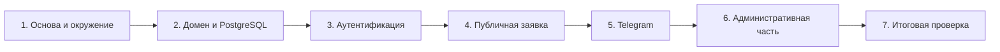

# LeadFlow — общий план реализации MVP

## 1. Назначение и порядок работы

План основан на `REQUIREMENTS.md` и утверждённой архитектуре из `ARCHITECTURE.md`.

Этапы и задачи выполняются строго последовательно. Каждая задача ниже является законченным, независимо проверяемым и ревьюируемым результатом. Перед началом конкретной задачи подготавливается её краткий детальный план; реализация начинается только после явной команды пользователя. После выполнения задачи запускаются проверки, проводится независимое ревью её diff в отдельной сессии, и работа останавливается до команды перейти дальше.

## 2. Этапы

| № | Этап | Результат | Критерий завершения |
|---|---|---|---|
| 1 | Основа приложения и локальное окружение | Проект переведён на MVC, добавлена согласованная структура каталогов, зависимости, Docker Compose для PostgreSQL и безопасная конфигурация | Решение собирается; PostgreSQL запускается локально; secrets не попадают в репозиторий |
| 2 | Доменная модель и PostgreSQL | Реализованы заявка, статусы, источники, история статусов, `ApplicationDbContext`, EF-конфигурации и миграции | Миграции применяются к PostgreSQL; ограничения, индексы и история статусов проверены тестами |
| 3 | Аутентификация и административная граница | Реализованы Identity, вход/выход, первоначальный менеджер из secrets/env и защита `/admin` | Анонимный доступ к заявкам закрыт; менеджер может безопасно войти |
| 4 | Публичный сценарий создания заявки | Работает лендинг с услугами из конфигурации, серверная валидация, создание заявки со статусом `New`, источником `Website` и первой записью истории | Валидная заявка сохраняется; невалидная не меняет БД; повтор POST не создаёт дубликат |
| 5 | Telegram-уведомления | Реализован интерфейс уведомлений, Telegram-клиент и отключённая реализация при отсутствии конфигурации | Заявка не теряется при ошибке Telegram; при настроенных secrets сообщение отправляется менеджеру |
| 6 | Административная работа с заявками | Реализованы список, фильтрация, сортировка, карточка, история статусов и редактирование статуса/одного внутреннего комментария | Менеджер видит и изменяет заявку; история создаётся только при фактической смене статуса |
| 7 | Завершение качества и проверка MVP | Доработаны UI, обработка ошибок, безопасность, тесты и эксплуатационные инструкции | Пройден полный MVP-сценарий, тесты и сборка; Docker и ручная Telegram smoke-проверка документированы |

## 3. Зависимости этапов

## 4. Задачи этапов

### Этап 1. Основа приложения и локальное окружение

| ID | Задача | Проверяемый результат |
|---|---|---|
| 1.1 | Подготовить MVC-основу приложения | Minimal API заменён MVC-конвейером, доступны базовый layout и страница ошибки; решение собирается |
| 1.2 | Подготовить локальное окружение PostgreSQL и конфигурацию | `compose.yaml` запускает PostgreSQL с persistent volume и healthcheck; секретные и несекретные настройки разделены; запуск документирован |

### Этап 2. Доменная модель и PostgreSQL

| ID | Задача | Проверяемый результат |
|---|---|---|
| 2.1 | Реализовать модель заявок и схему хранения | Сущности `Lead`, статусы, источники, история, `ApplicationDbContext`, EF-конфигурации и миграция создают согласованную PostgreSQL-схему |
| 2.2 | Проверить persistence-контракт | Автоматические тесты подтверждают ограничения модели, индексы и атомарное сохранение первой записи истории |

### Этап 3. Аутентификация и административная граница

| ID | Задача | Проверяемый результат |
|---|---|---|
| 3.1 | Реализовать аутентификацию менеджера и защищённую административную границу | Первоначальный менеджер идемпотентно создаётся из secrets/env; менеджер может войти и выйти; анонимный пользователь не получает доступ к персональным данным |

### Этап 4. Публичный сценарий создания заявки

| ID | Задача | Проверяемый результат |
|---|---|---|
| 4.1 | Реализовать публичное создание заявки | Лендинг показывает услуги из конфигурации и форму с серверной валидацией; валидный POST создаёт `Lead` со статусом `New`, источником `Website` и первой историей, затем использует Post/Redirect/Get |

### Этап 5. Telegram-уведомления

| ID | Задача | Проверяемый результат |
|---|---|---|
| 5.1 | Реализовать Telegram-уведомления о новой заявке | При настроенных `BotToken` и `ChatId` после сохранения отправляется корректное сообщение; без настроек используется отключённая реализация, а timeout или ошибка Bot API не отменяют сохранённую заявку |

### Этап 6. Административная работа с заявками

| ID | Задача | Проверяемый результат |
|---|---|---|
| 6.1 | Реализовать список заявок менеджера | В `/admin/leads` отображаются обязательные поля, фильтр по статусу и сортировка по дате выполняются на стороне БД |
| 6.2 | Реализовать карточку и обработку заявки | Карточка показывает контакты, комментарий и историю; менеджер изменяет статус и единственный внутренний комментарий; новая история появляется только при фактической смене статуса |

### Этап 7. Завершение качества и проверка MVP

| ID | Задача | Проверяемый результат |
|---|---|---|
| 7.1 | Завершить автоматическое покрытие ключевых сценариев | MVC/integration tests проверяют публичное создание, доступ администратора, работу с заявкой и отказ Telegram; все тесты проходят |
| 7.2 | Подготовить эксплуатационные инструкции и провести итоговую проверку | Документирован запуск PostgreSQL, миграций и secrets; пройдены сборка, полный MVP-сценарий и ручная Telegram smoke-проверка с реальными credentials |

## 5. Границы MVP

В этот план не входят dashboard, управление пользователями и услугами, дополнительные источники заявок, гарантированная повторная доставка уведомлений, CAPTCHA/rate limiting, роли, публичный REST API и отдельный frontend. Они могут быть рассмотрены только в отдельном последующем плане после появления требований.
